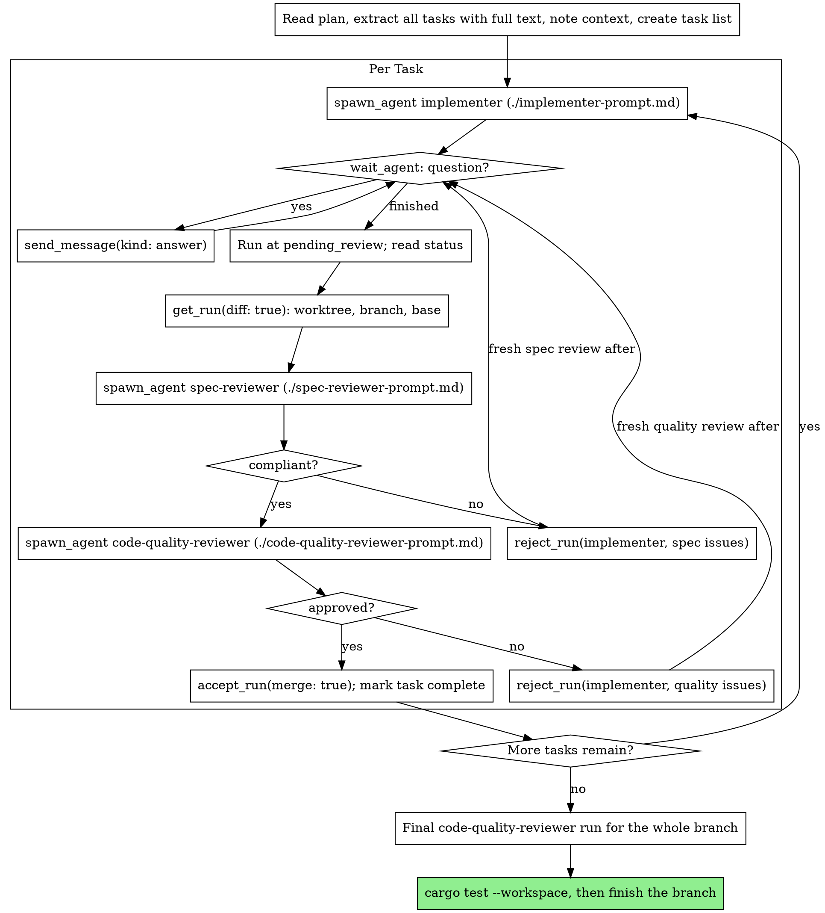

# Subagent-Driven Development

Execute a plan one task at a time. Each task gets a fresh `implementer` run through superorchestrator, held at the review gate. Two review runs follow: spec compliance first, then code quality. Fixes go back to the same implementer run with `reject_run`. `accept_run(merge: true)` lands the task on the feature branch.

**Why subagents:** You delegate tasks to agents with isolated context. You write exactly the brief they need, so they stay focused and succeed. They never inherit your session's context or history. This also preserves your own context for coordination.

**Core principle:** Fresh run per task + review gate + two-stage review (spec then quality) = high quality, fast iteration.

**Continuous execution:** Do not pause to check in with your human partner between tasks. Execute all tasks from the plan without stopping. The only reasons to stop are: BLOCKED status you cannot resolve, ambiguity that genuinely prevents progress, or all tasks complete. "Should I continue?" prompts and progress summaries waste their time. They asked you to execute the plan, so execute it.

## Before the First Task

1. Load the `use-superorchestrator-mcp` skill and call `list_harnesses`. If the tools fail, or no non-Claude account is signed in with headroom, use the [native fallback](#native-fallback).
2. Have a plan with the goal, acceptance criteria (the commands that must pass) and out-of-scope items for each task. Commit it.
3. Work in a feature branch checkout, never `main` without explicit user consent. Keep its tracked files clean while runs are open: `accept_run(merge: true)` refuses to merge into a dirty checkout or one that changed branch. Untracked files are fine.
4. Read the plan once. Extract every task with its full text and context, and create the task list.

## The Process



### Per task

1. **Dispatch the implementer** with `./implementer-prompt.md`: `spawn_agent(agent: "implementer", review: true, checks, output_schema, wait: false)` from the feature checkout. The run gets its own worktree at the feature branch's `HEAD`.
2. **Wait** with `wait_agent([run], timeout_ms)`. Answer each `question` update with `send_message(run, text, kind: "answer")`. Progress updates need no action. Keep waiting until the run is in `finished`.
3. **Read the result.** The run stops at `pending_review` with a result that matches the schema. Handle its status (below). When `failed_checks` is set, the checks failed twice: reject the run with the check output, or treat it as BLOCKED.
4. **Look at the change** with `get_run(run, diff: true)`. Note `worktree`, `branch` and `diff.base`. Skim the patch yourself. Review with the diff, not by reading files.
5. **Spec review.** Spawn `spec-reviewer` with `cwd: <worktree>` (`./spec-reviewer-prompt.md`). Its own worktree starts at the implementer's tip. When it is not compliant, `reject_run(run, feedback)` with the issues. The implementer fixes them on the same native session, the checks run again, and the run returns to `pending_review`. Spawn a fresh spec reviewer with the earlier issues listed. Repeat until compliant.
6. **Code quality review.** Only after spec compliance passes. Spawn `code-quality-reviewer` the same way (`./code-quality-reviewer-prompt.md`). Reject with Critical and Important issues and review again until approved. Decide on Minor issues yourself.
7. **Land it** with `accept_run(run, merge: true)`. A refusal names its cause (dirty checkout, other branch, dirty worktree, conflict). Fix the cause and accept again. Mark the task complete.

### After all tasks

1. Spawn a final `code-quality-reviewer` with `cwd` set to the feature checkout and `base` set to `git merge-base main HEAD`. Send fixes through a new implementer run with the same flow.
2. Run `cargo test --workspace` once in the feature checkout, in the background.
3. Finish the branch (superpowers:finishing-a-development-branch).

## Model Selection

The router picks the harness, account and model from the task's complexity. On the first dispatch:

- Leave `harness` at `auto`. Pass no `model`, `effort` or `account`.
- Never pass `harness: "claude"` or a Claude account. Claude accounts belong to the orchestrator.
- Never use the `implementer-haiku` or `implementer-sonnet` profiles through superorchestrator. They pin Claude models and exist for the native fallback.
- `route(prompt, agent)` previews the pick without running anything.

**Escalation:** re-dispatch with a `model` ref from a higher level, such as `codex/gpt-6.1-sol/high`. Take it from the `choices` that `list_harnesses` marks eligible. The ref also sets harness and effort.

## Handling Implementer Status

**DONE:** Proceed to spec review.

**DONE_WITH_CONCERNS:** The implementer finished but flagged doubts. Read the concerns. When they concern correctness or scope, address them before review. When they are observations (for example "this file is getting large"), note them and proceed to review.

**NEEDS_CONTEXT:** Most questions arrive during the run through `ask_parent`. When the final status is NEEDS_CONTEXT, send the missing context with `send_message`. At the gate this counts as a rejection, so the run resumes with it.

**BLOCKED:** Assess the blocker:
1. A context problem: send more context with `send_message`.
2. The task needs more reasoning: `cancel_agent` the run and re-dispatch with a higher-level model ref.
3. The task is too large: cancel it and split it into smaller tasks.
4. The plan itself is wrong: escalate to the human.

**Never** ignore an escalation or force the same model to retry without changes. If the implementer said it is stuck, something needs to change.

## Parallel Tasks

Default to one task at a time. Tasks with no dependency on each other and no shared files may run together, because each run has its own worktree:

- Spawn each implementer with `wait: false`, then `wait_agent` on all of them.
- Review each run as above.
- Land them one at a time with `accept_run(merge: true)`. On a conflict, reject the run and tell the implementer to merge the feature branch into its branch, resolve the conflict and commit.

Account caps still apply: runs over the cap wait in `queued`.

## Native Fallback

When superorchestrator is unavailable, run the same process with the Agent tool and the project agents in `.claude/agents/`:

| Role | `subagent_type` |
|---|---|
| Mechanical implementation: 1-2 files, complete spec, isolated functions | `implementer-haiku` |
| Integration and judgment implementation: multi-file, debugging, pattern matching | `implementer-sonnet` |
| Spec compliance review | `spec-reviewer` |
| Code quality review, and the final review | `code-quality-reviewer` |

- Use the same briefs from the templates, without the `spawn_agent` fields and the result schema.
- Do not pass `model` or `effort`. The agent files pin `claude-haiku-5-5` and `claude-sonnet-5-5` at medium effort, and `.claude/hooks/enforce-subagent-models.py` denies anything else.
- Native subagents share this checkout. Run one implementer at a time, on the feature branch. Reviewers review the git range `BASE_SHA..HEAD_SHA`.
- Send fixes to the same implementer with SendMessage. If `implementer-haiku` is blocked on reasoning, re-dispatch to `implementer-sonnet`. If `implementer-sonnet` is blocked, split the task or take it to the human.

## Prompt Templates

- `./implementer-prompt.md`: dispatch the implementer
- `./spec-reviewer-prompt.md`: dispatch the spec compliance reviewer
- `./code-quality-reviewer-prompt.md`: dispatch the code quality reviewer
- `./code-reviewer-template.md`: full review brief used by the code quality reviewer and the final review

## Example Workflow

```
You: I'm using Subagent-Driven Development to execute this plan.

[Read plan file once: docs/plans/feature-plan.md]
[Extract all 5 tasks with full text and context, create the task list]
[list_harnesses: agy and opencode accounts have headroom]

Task 1: Hook installation script

[spawn_agent(agent: "implementer", review: true, checks: [...], output_schema, wait: false)]
[wait_agent: update {type: "question", question: "User or system level hooks?"}]
[send_message(kind: "answer", text: "User level (~/.config/superpowers/hooks/)")]
[wait_agent: finished, state pending_review]
  status DONE: install-hook command, 5/5 tests passing, self-review added --force

[get_run(diff: true): worktree, branch so/task-1-..., base]
[spawn_agent(agent: "spec-reviewer", cwd: worktree) -> compliant: true]
[spawn_agent(agent: "code-quality-reviewer", cwd: worktree) -> approved: true]
[accept_run(merge: true): fast-forward]
[Mark Task 1 complete]

Task 2: Recovery modes

[spawn implementer, wait: finished, status DONE, 8/8 tests passing]
[spec-reviewer -> compliant: false
   missing: progress reporting ("report every 100 items")
   extra: --json flag (not requested)]
[reject_run(run, "Remove --json; add progress reporting every 100 items")]
[wait_agent: finished again at pending_review]
[fresh spec-reviewer with the earlier issues -> compliant: true]
[code-quality-reviewer -> approved: false, important: magic number 100]
[reject_run(run, "Extract PROGRESS_INTERVAL")]
[fresh code-quality-reviewer -> approved: true]
[accept_run(merge: true)]
[Mark Task 2 complete]

...

[After all tasks]
[Final code-quality-reviewer on the feature checkout -> approved: true]
[cargo test --workspace passes]

Done!
```

## Red Flags

**Never:**
- Start implementation on main/master without explicit user consent
- Edit tracked files in the feature checkout while runs are open
- Skip reviews (spec compliance OR code quality)
- Proceed with unfixed issues
- Run parallel implementers on tasks that share files or depend on each other
- Make the subagent read the plan file (provide the full text instead)
- Skip scene-setting context (the subagent needs to understand where the task fits)
- Leave a `question` update unanswered
- Accept "close enough" on spec compliance (spec reviewer found issues = not done)
- Skip review loops (reviewer found issues = implementer fixes = review again)
- Let implementer self-review replace actual review (both are needed)
- **Start code quality review before spec compliance passes** (wrong order)
- Move to the next task while either review has open issues, or before `accept_run` landed it
- Pin the claude harness or a Claude account for a subagent

**If a reviewer finds issues:**
- `reject_run` sends them to the same implementer run
- A fresh reviewer reviews again, with the earlier issues listed
- Repeat until approved

**If the implementer fails the task:**
- Send specific instructions with `reject_run`, or cancel and re-dispatch
- Don't fix it yourself (context pollution)

## Integration

**Required workflow skills:**
- **use-superorchestrator-mcp**: the MCP tools this skill dispatches through
- **superpowers:writing-plans**: creates the plan this skill executes
- **superpowers:finishing-a-development-branch**: completes the branch after all tasks

**Subagents should use:**
- **superpowers:test-driven-development**: implementers follow TDD for each task
