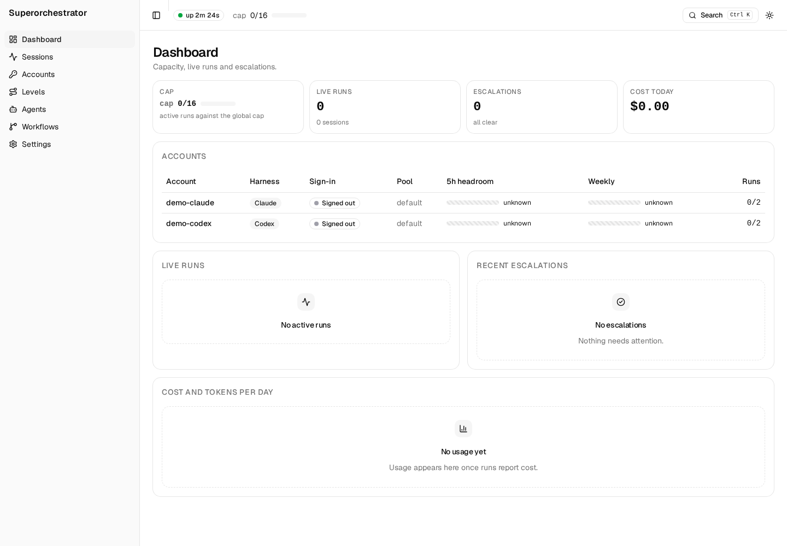

# superorchestrator

Superorchestrator lets an orchestrator delegate work to Codex, Antigravity (`agy`), OpenCode or Claude across many logged-in accounts. It records every delegation so you can trace, join and review each run.



## What it does

- Routes work to an account based on model, complexity, usage and configured caps.
- Runs subagents in worktrees with a review gate to inspect, reject or land changes.
- Tracks sessions, runs, events, usage and account headroom in the web UI and terminal UI.
- Provides workflow primitives for parallel and multi-step work.
- Adds a Claude Code monitor plugin: open `/so-monitor` for account quota and the run timeline.

## Install

Install the latest [release](https://github.com/datamonsterr/superorchestrator/releases), or run the installer (it verifies the checksum):

```sh
curl -fsSL https://raw.githubusercontent.com/datamonsterr/superorchestrator/main/install.sh | sh
```

The binary installs to `~/.local/bin`. Set `SUPERORCHESTRATOR_INSTALL_DIR` to change that.

## Quickstart

```sh
superorchestrator setup
claude
```

Ask Claude Code to delegate a task. `setup` initializes the config, offers to add accounts for installed harnesses, and registers the MCP server and skills. Run `superorchestrator doctor` to check the setup. See the [getting started guide](docs/guide/getting-started.md).

## Interfaces

- [Web UI](docs/guide/web-ui.md): sessions, accounts, routing levels, settings and live run timelines.
- [Terminal UI](docs/guide/tui.md): monitor runs and manage levels.
- [Claude Code plugin](plugin/README.md): MCP setup and the `/so-monitor` pane.

## Guides

- [Use cases](docs/guide/use-cases.md) · [Accounts](docs/guide/accounts.md) · [Routing](docs/guide/routing.md)
- [Agents](docs/guide/agents.md) · [Workflows](docs/guide/workflows.md) · [Reviewing runs](docs/guide/review.md)
- [Notifications](docs/guide/notifications.md) · [Configuration](docs/guide/config.md) · [Security](docs/guide/security.md)
- [Troubleshooting](docs/guide/troubleshooting.md) · [Migrating](docs/guide/migrate.md)

## Build from source

Requires Rust (see `rust-toolchain.toml`), Node 24 and pnpm. Build the web UI before the binary; the binary embeds it.

```sh
pnpm -C web install --frozen-lockfile
pnpm -C web build
cargo build --release -p superorchestrator
```

MIT licensed. See [LICENSE](LICENSE).
